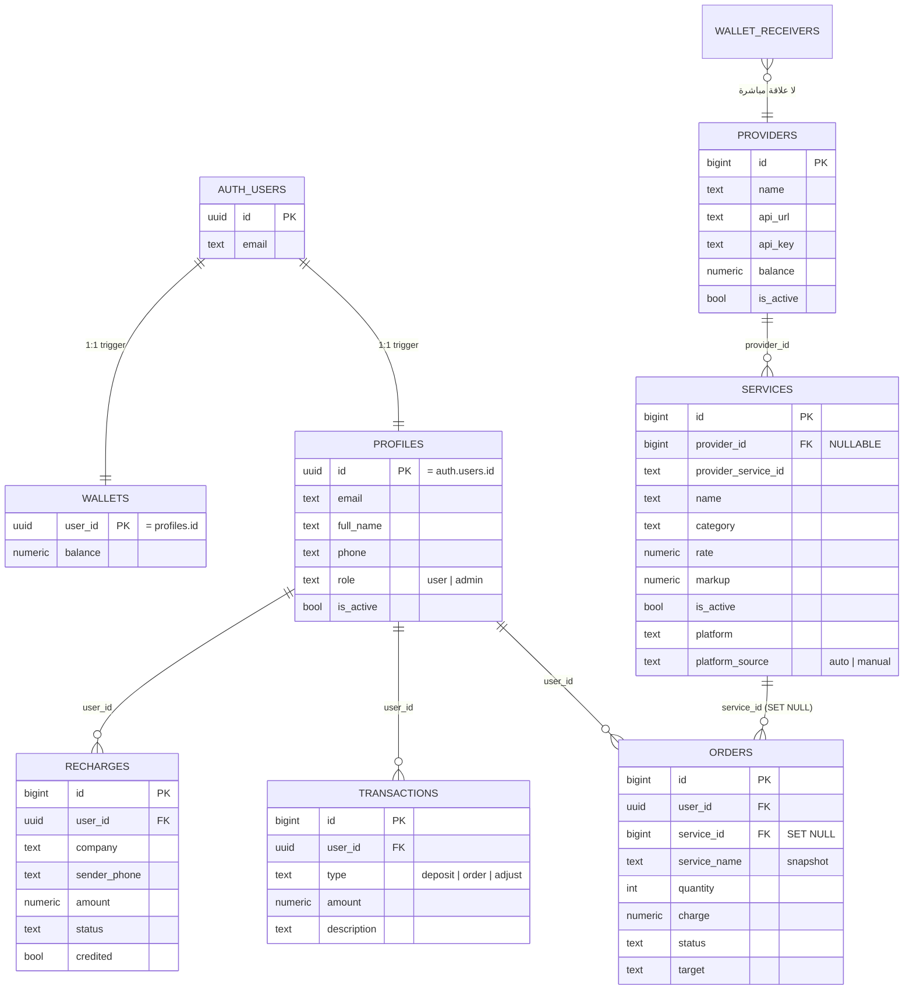
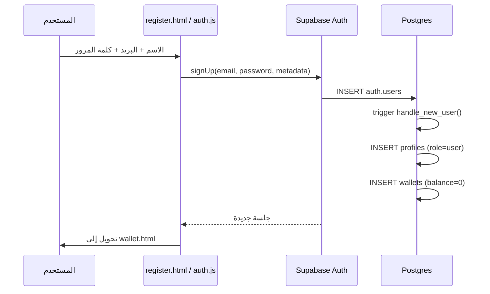
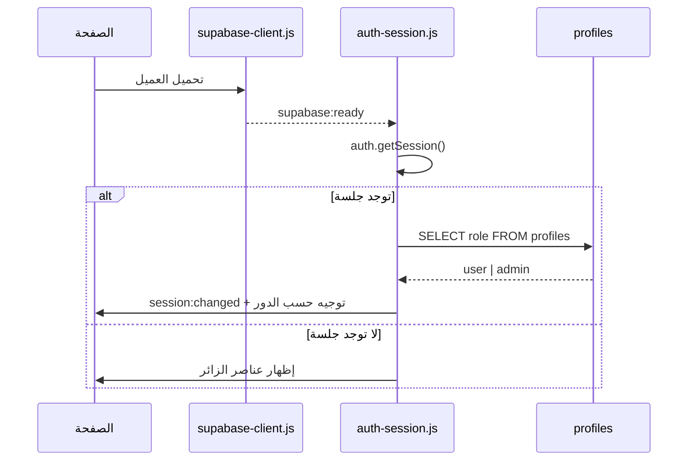
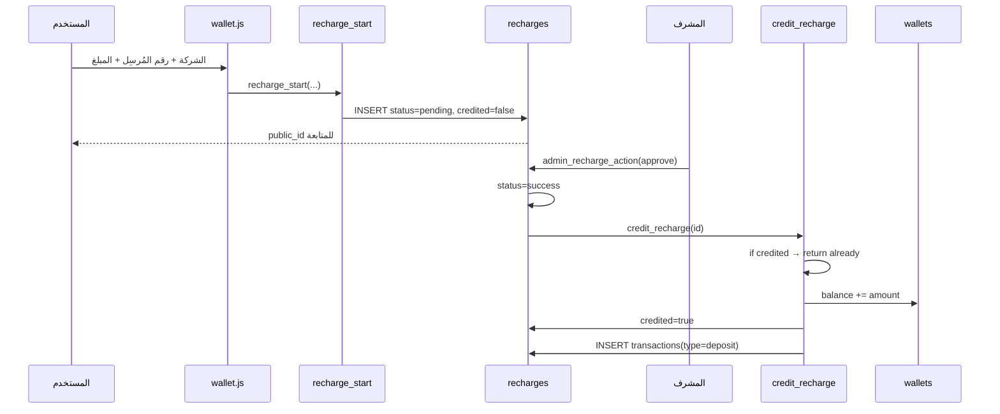
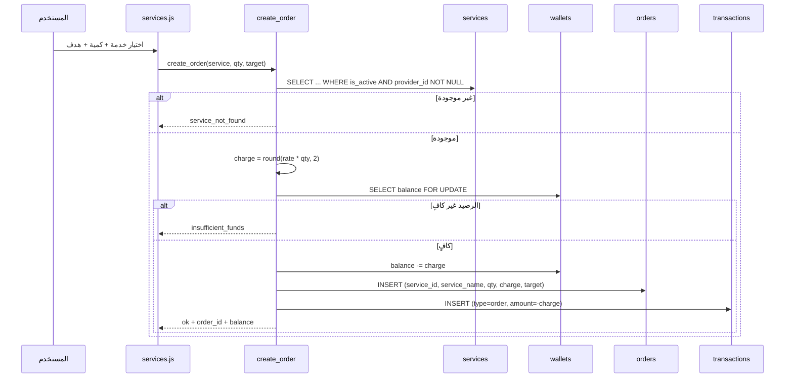
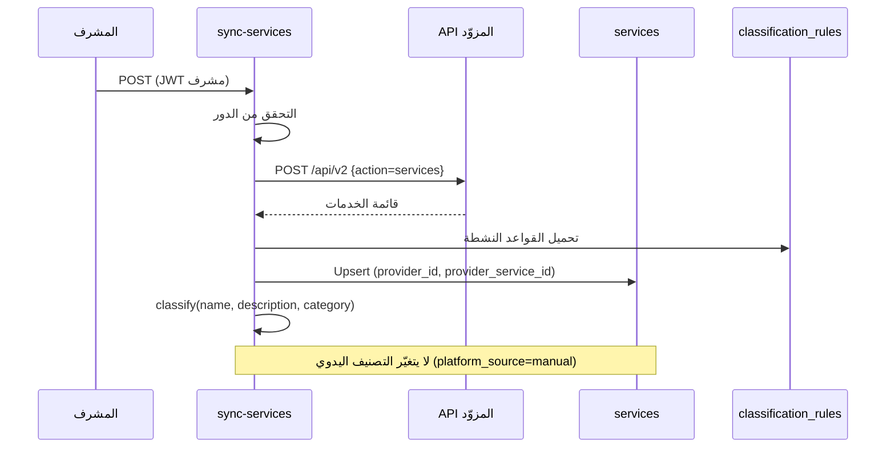
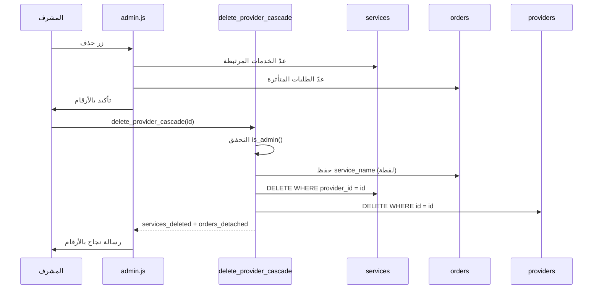

# قاعدة البيانات والتدفقات — شرح نظري مبسّط

> هذا الملف يشرح **ماذا يُخزَّن** و**كيف يتحرك** داخل ليبيا GO.
> المخططات مكتوبة بـ Mermaid (تظهر في GitHub وVS Code)، ومعه نسخة نصية بسيطة
> في نهاية الملف، ومخطط مرئي في `docs/database-map.html`.

---

## 1. الفكرة العامة في سطرين

- **Supabase Auth** يحفظ الهوية (من أنت).
- **جداول `public`** تحفظ المال والخدمات والطلبات، و**RLS** يمنع أي مستخدم من رؤية أو تعديل ما لا يملكه.
- أي عملية تمسّ المال تتم عبر **دالة على الخادم**، لا عبر `UPDATE` من المتصفح.

```
المتصفح  →  Supabase Auth (هوية)  →  Postgres + RLS  →  RPC (منطق المال)
```

---

## 2. مخطط الكيانات



> ملاحظة: `providers` و`wallet_receivers` لا تربطهما علاقة مباشرة؛ أرقام الاستقبال
> تُدار يدويًا في الإعدادات، والمزوّدون مصدر الخدمات.

---

## 3. الجداول بالتفصيل

### 3.1 `profiles` — هوية المستخدم داخل التطبيق

| الحقل | النوع | ملاحظات |
|---|---|---|
| `id` | uuid PK | نفس `auth.users.id` |
| `email` | text | نسخة للعرض والبحث |
| `full_name` | text | من بيانات التسجيل |
| `phone` | text | اختياري |
| `avatar_url` | text | اختياري |
| `role` | text | `user` أو `admin` — **الأساس في كل الصلاحيات** |
| `is_active` | bool | تعطيل الحساب يمنع الإدارة |
| `created_at` / `updated_at` | timestamptz | توقيتات |

### 3.2 `wallets` — الرصيد

| الحقل | النوع | ملاحظات |
|---|---|---|
| `user_id` | uuid PK | مستخدم واحد = محفظة واحدة |
| `balance` | numeric | **لا يُعدّل من الواجهة** |
| `updated_at` | timestamptz | |

### 3.3 `transactions` — السجل المالي

| الحقل | النوع | ملاحظات |
|---|---|---|
| `id` | bigint PK | |
| `user_id` | uuid | صاحب الحركة |
| `type` | text | `deposit`, `order`, ... |
| `amount` | numeric | موجب = إيداع، سالب = خصم |
| `description` | text | نص عربي للعرض |
| `created_at` | timestamptz | |

> هذا الجدول **سجل تدقيق**: لا يُحذف منه شيء عند حذف مزوّد أو خدمة.

### 3.4 `providers` — المزوّدون

| الحقل | النوع | ملاحظات |
|---|---|---|
| `id` | bigint PK | |
| `name` | text | اسم المزوّد |
| `api_url` / `api_key` | text | بيانات الاتصال (لا تُعرض للعميل) |
| `balance` | numeric | رصيد لدى المزوّد (اختياري) |
| `is_active` | bool | المزامنة تقرأ النشطين فقط |
| `sort_order` | int | ترتيب العرض |
| `dashboard_url` | text | رابط لوحة المزوّد |

### 3.5 `services` — الخدمات

| الحقل | النوع | ملاحظات |
|---|---|---|
| `id` | bigint PK | معرّف الخدمة العام |
| `provider_id` | bigint NULL | **قابل للـ NULL**؛ يصبح NULL عند فصل الخدمة |
| `provider_service_id` | text | معرّف الخدمة عند المزوّد |
| `name` | text | اسم الخدمة |
| `category` | text | تصنيف المزوّد (نص حر) |
| `description` | text | وصف اختياري |
| `rate` | numeric | سعر الوحدة |
| `cost` | numeric | تكلفة المزوّد |
| `markup` | numeric | هامش الربح |
| `min_qty` / `max_qty` | int | حدود الكمية |
| `is_active` | bool | لا تظهر للزوار إن كانت false |
| `sort_order` | int | ترتيب العرض |
| `platform` | text | تصنيف محلي (instagram, tiktok, ... أو other) |
| `platform_source` | text | `auto` تلقائي / `manual` يدوي |
| `platform_locked` | bool | يمنع التصنيف التلقائي من التغيير |

**قيد فريد مهم:** `(provider_id, provider_service_id)` — عليه تعتمد المزامنة
(Upsert) حتى لا تتكرر الخدمات.

### 3.6 `orders` — الطلبات

| الحقل | النوع | ملاحظات |
|---|---|---|
| `id` | bigint PK | |
| `user_id` | uuid | صاحب الطلب |
| `service_id` | bigint NULL | يصبح NULL إذا حُذفت الخدمة |
| `service_name` | text | **لقطة اسم الخدمة** وقت الطلب |
| `quantity` | int | الكمية |
| `charge` | numeric | المبلغ المخصوم |
| `status` | text | `pending` / `processing` / `completed` / `canceled` / `refunded` |
| `target` | text | الرابط أو الرقم المستهدف |
| `created_at` | timestamptz | |

> بسبب `service_name` و`ON DELETE SET NULL`، حذف خدمة **لا يفقد** الطلب اسمه
> ولا مبلغه ولا حالته.

### 3.7 `recharges` — طلبات شحن المحفظة

| الحقل | النوع | ملاحظات |
|---|---|---|
| `id` | bigint PK | |
| `public_id` | uuid | معرّف عام آمن للمشاركة |
| `user_id` | uuid | |
| `company` | text | `libyana` / `almadar` |
| `sender_phone` | text | رقم المُرسِل |
| `receiver_phone` | text | رقم الاستقبال |
| `amount` | numeric | المبلغ |
| `status` | text | `pending` / `needs_review` / `success` / `failed` / `cancelled` |
| `credited` | bool | **حارس التكرار**: يمنع إضافة الرصيد مرتين |
| `provider_ref` | text | مرجع SMS RAEED |
| `start_request_id` / `poll_request_id` | bigint | متابعة الطلب لدى المزوّد |
| `created_at` / `updated_at` | timestamptz | |

### 3.8 `wallet_receivers` — أرقام الاستقبال

| الحقل | ملاحظات |
|---|---|
| `id`, `company`, `phone`, `is_active`, `sort_order`, `created_at` | تُعرض للمستخدم عند الشحن |

### 3.9 `app_settings` — إعدادات عامة

| الحقل | ملاحظات |
|---|---|
| `key` (PK), `value`, `updated_at` | مفاتيح مثل `smsraed_base_url` و`smsraed_enabled` |

### 3.10 `service_classification_rules` — قواعد التصنيف

| الحقل | ملاحظات |
|---|---|
| `id`, `platform`, `keyword`, `priority`, `is_active` | كلمة مفتاحية ← منصة، والأولوية الأقل تفصل التعارض |

---

## 4. الصلاحيات (RLS) — باختصار

| الجدول | من يقرأ | من يكتب |
|---|---|---|
| `services` | الجميع للخدمات `is_active`، والمشرف للكل | المشرف |
| `providers` | المشرف فقط | المشرف |
| `orders` | صاحب الطلب + المشرف | المشرف (الحالة)، والخادم عند الإنشاء |
| `recharges` | صاحب الطلب + المشرف | الخادم + المشرف |
| `wallets` | صاحب المحفظة + المشرف | الخادم فقط (RPC) |
| `transactions` | صاحب الحركة + المشرف | الخادم فقط |
| `profiles` | صاحب الملف + المشرف | صاحب الملف (حقول محدودة) + المشرف |
| `wallet_receivers` | الجميع (النشطة) | المشرف |
| `app_settings` | المشرف | المشرف |
| `service_classification_rules` | المشرف | المشرف |

**نمط الحماية المزدوج:** RLS يحمي الجدول، والدالة تتحقق من `is_admin()` مرة أخرى.
هذا يمنع الاعتماد على الواجهة وحدها.

---

## 5. تدفق تسجيل المستخدم



**لا تُنشئ المحفظة يدويًا في الواجهة.** المشغّل (trigger) يفعل ذلك، و`create_order`
يستخدم `insert ... on conflict do nothing` كاحتياط إضافي.

---

## 6. تدفق الدخول والجلسة



- تُخزَّن الجلسة في `localStorage` عند تفعيل «تذكّرني»، وإلا في `sessionStorage`.
- الخروج يستدعي `auth.signOut()` ثم يعيد التوجيه إلى `login.html`.

---

## 7. تدفق شحن المحفظة



**حارس التكرار:** `credited` يضمن أن الاعتماد المتكرر لا يضاعف الرصيد.
**التحقق النهائي** من وصول المبلغ يتم على الخادم (SMS RAEED / اعتماد المشرف)، وليس في الواجهة.

---

## 8. تدفق إنشاء الطلب



**نقاط مهمة:**

- `FOR UPDATE` يمنع خصم الرصيد مرتين عند الطلبات المتزامنة.
- `service_name` يُحفظ وقت الإنشاء، فيبقى الاسم حتى لو حُذفت الخدمة لاحقًا.
- الخدمة التي `provider_id = NULL` لا يمكن طلبها.

---

## 9. تدفق المزامنة والتصنيف



**أولوية التصنيف:** `category` ← ثم `name + description` ← التعارض ⇒ `other`.
**التطبيع:** توحيد الألف/الياء/التاء المربوطة وإزالة التشكيل.

---

## 10. تدفق حذف المزوّد (الحذف التام)



**ما لا يحدث:** لا تُحذف طلبات، ولا معاملات، ولا يُعدَّل رصيد أي مستخدم.

**تنظيف اليتيمة:** `cleanup_orphan_services()` تحذف الخدمات التي
`provider_id IS NULL` و`is_active = false` فقط، ولا تعمل تلقائيًا.

---

## 11. ثوابت مالية وأمنية

1. `charge = round(rate × quantity, 2)` — على الخادم.
2. الرصيد لا يصبح سالبًا (فحص قبل الخصم).
3. `transactions` سجل غير قابل للحذف من الواجهة.
4. `recharges.credited` يمنع الازدواج.
5. كل دالة إدارية تتحقق من `is_admin(auth.uid())`.
6. مشرف الحساب يجب أن يكون `is_active = true` وإلا فشل `is_admin`.
7. لا توجد أرصدة تجريبية في الواجهة.

---

## 12. مخطط نصي بسيط (بدون Mermaid)

```
                 ┌──────────────┐
                 │  auth.users  │  (الهوية)
                 └──────┬───────┘
                        │ trigger عند التسجيل
            ┌───────────┴────────────┐
            ▼                        ▼
     ┌─────────────┐          ┌─────────────┐
     │  profiles   │          │   wallets   │
     │ role/is_active │        │   balance   │
     └──────┬──────┘          └──────┬──────┘
            │                        │
            │ 1:N                    │ 1:1 (رصيد)
            ▼                        ▼
     ┌─────────────┐          ┌─────────────┐
     │   orders    │◄─────────│transactions │
     │ service_name│  سجل     └─────────────┘
     └──────┬──────┘
            │ service_id (SET NULL)
            ▼
     ┌─────────────┐        ┌─────────────┐
     │  services   │◄───────│  providers  │
     │ platform    │ 1:N    └─────────────┘
     └─────────────┘

     recharges ──► wallets (عبر credit_recharge)
     wallet_receivers (أرقام الاستقبال)
     service_classification_rules (قواعد التصنيف)
```

---

## 13. أين أبحث عن ماذا؟

| أريد أن… | الملف/الجدول |
|---|---|
| أعرف كيف تُحمَّل الصفحة | `docs/ARCHITECTURE.md` القسم 4 |
| أضيف صفحة إدارية | `admin/admin.js` (NAV + MODULES) |
| أعدّل منطق الطلب | دالة `create_order` في قاعدة البيانات |
| أعدّل الشحن | `recharge_start` + `credit_recharge` |
| أعدّل التصنيف | `js/platforms.js` + `service_classification_rules` |
| أفحص الصلاحيات | `pg_policies` + دوال `SECURITY DEFINER` |
